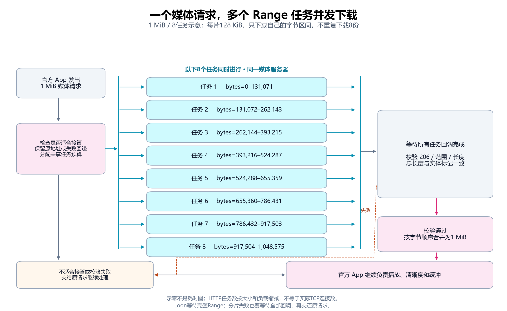
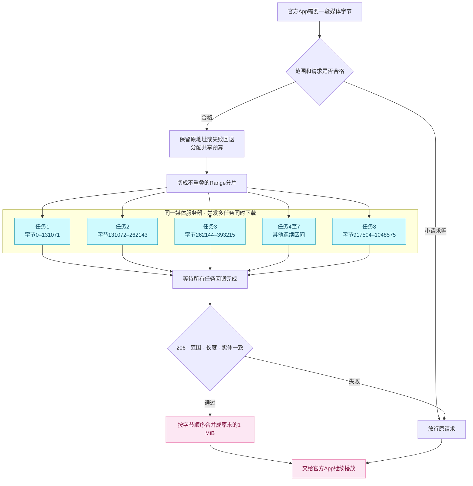
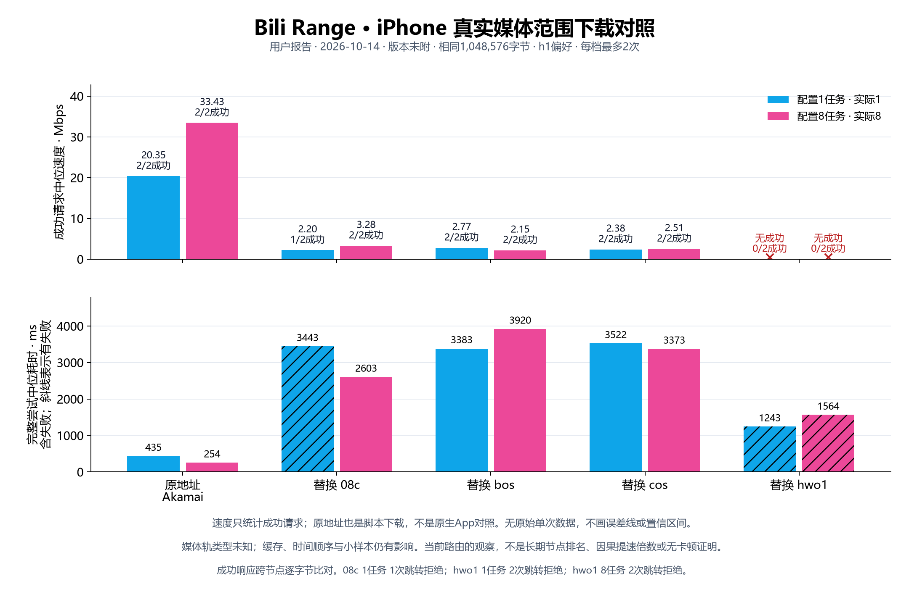
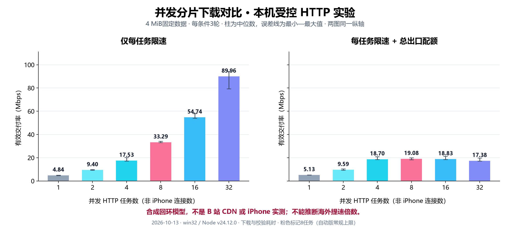

<div align="center">


# Bili Range

**让海外 iPhone 看 B 站，少调参，多看视频。**

aijc123 为 Bilibili 官方 App 开发的 Loon 自动加速适配。

[](CHANGELOG.md) [](https://github.com/aijc123/Bilibili-Redirect-US/actions/workflows/range-lab.yml) [](NOTICE)

### [导入 Loon 当前体验候选](https://raw.githubusercontent.com/aijc123/Bilibili-Redirect-US/main/dist/candidate/BiliBili.Range.Adaptive.plugin)

[安装](#安装) · [确认生效](#确认生效) · [效果记录](#效果记录) · [原理](#原理) · [常见问题](#常见问题) · [反馈](#反馈) · [更新日志](CHANGELOG.md)

</div>

## 为什么做这个项目

海外宽带测速正常，B站某些视频仍会加载慢。换CDN有时有帮助，但逐个选节点、猜线程数和读长日志并不方便。Bili Range把节点回退、有限Range并发和本机诊断放进已有的Loon，让你继续使用官方App。

- **一个开关**：日常只保留“启用加速”，旧高级参数不会继续控制自动版。
- **保留原地址**：先使用官方下发的服务器，异常时再回退到大陆、海外与香港候选；不默认替换到大陆CDN。
- **适量并发**：常规8个HTTP任务，按大小、负载和错误收缩，有同条件证据才试更高档；小请求直接放行。
- **短诊断**：看实际请求处理版本、近期成功/失败和是否有新样本；完整统计按需打开。
- **长期维护**：订阅地址固定，脚本固定到版本标签，源码、许可和验证可追溯。

Loon适配、调度预算、自动策略、诊断和独立发布由 **[aijc123](https://github.com/aijc123)** 完成。范围与SIDX工具直接复用已有开源模块，[来源与credit](#来源与credit)完整保留。

## 安装

1. 将上方自动版 `.plugin` 地址导入Loon；已经订阅则更新同一地址。
2. 按[Loon官方MitM说明](https://nsloon.app/docs/category/mitm/)完成证书安装与信任，只启用这一份B站CDN/Range插件。
3. 保持“启用加速”打开，回到官方App看视频。

不用填写CDN、线程、DNS或倍速。当前体验候选 **0.1.19-experimental**，要求Loon3.5.1；DNS诊断要求Build988+。已修正默认替换原地址的策略，连续播放效果仍待验证；0.1.14及0.1.18固定版本保留回退。[手机详细步骤](docs/USAGE.md)

| 使用场景 | 当前范围 |
| --- | --- |
| iPhone + Loon + Bilibili官方App | 已有真实接管与体验反馈；自动版继续验证 |
| iPad + Loon | 插件声明支持，尚无本项目iPad真机效果证据 |
| 电脑浏览器 | 可使用原[BTR](https://github.com/MrTangLuyao/Bilibili-thread-ripper)；本订阅针对Loon |

## 确认生效

播放视频30–60秒后立即运行 **Bili Range 诊断**。重点看“最近已标记请求脚本”是否为当前版本，以及是否有新的接管尝试。诊断脚本更新与实际下载脚本生效是两件事。

显示“没有最近30秒样本”可能是已经缓冲、暂停或近期主要为直接放行的小请求，当前速度应视为未知。累计接管次数包含升级前数据，不能用它判断新版提速。实际是否流畅仍以播放体验为准。[怎样读摘要](docs/USAGE.md#如何读短摘要)

## 效果记录

| 目前已有证据 | 解读 |
| --- | --- |
| 同视频、同清晰度、同Wi-Fi的iPhone对照 | 用户反馈比原Redirect更流畅、加载更快；未量化因果倍数 |
| 8路与32路请求层观察 | 当前更支持8路/128 KiB策略；缓存、时间及分片条件未完全控制 |
| 已知实际体验 | 0.1.17的1080高帧率1倍速仍停顿；0.1.19疑似杜比视界1倍速严重卡顿；0.1.20尚无手机验收 |
| 自动检查与发布验证 | 当前候选206项检查通过；原地址优先的连续播放及4K/1.5倍速效果仍待验证 |

**当前没有解决全部播放卡顿，不能宣称全链路最优或持续无卡顿。** 新自动策略的实际净收益、杜比视界及4K/1.5倍速能力仍待验证。我们展示本项目自己的证据，不把参考项目的速度图当作手机版成绩。[方法、观察数据与限制](docs/EVIDENCE.md)

## 原理

播放器需要一段媒体字节时，Loon先判断是否适合接管。合格请求在选定的同一个CDN上切成有界小块，并发下载；全部完成并严格校验后拼回，交给官方App。失败数据不拼接，原请求继续处理。



<details>
<summary>查看可编辑的Mermaid流程图</summary>



</details>

图中以1 MiB请求拆成8个128 KiB分片为例：每个任务下载不同字节，不是把同一段重复下8遍。任务同时进行，返回时按顺序拼好。自动版仍会按大小和负载减少任务；HTTP任务数不等于Loon已报告的TCP连接数。

### 并发能带来多少速度收益？



这张图来自用户第二轮实际iPhone测速摘要：相同1 MiB，原地址Akamai单任务20.35Mbps、实际8任务33.43Mbps，均2/2成功；替换节点约2–3.3Mbps，hwo1两档均无成功。失败没有变成虚假的速度。[本轮数据](benchmarks/phone-media-2026-10-14-run2.json)没有版本头，明确保留版本未知。原地址同样由脚本下载，**不是原生App对照，也不是长期节点排名或无卡顿证明**；媒体轨类型未知，每档最多两次。未取得原始单次数据，因此不画误差线。

[第一轮图](pics/phone-media-observed.png)与[数据](benchmarks/phone-media-2026-10-14.json)另行保留：897,932字节、实际1/6任务，原地址20.92/27.21Mbps。两轮范围和节点不同，不合并统计。[0.1.19普通播放诊断](benchmarks/phone-playback-0.1.19-2026-10-14.json)随后仍出现密集网络错误，说明暂停时的短测峰值不能替代连续播放验收。

据此，0.1.19候选优先保留官方下发的原地址，在原地址上做有限并发，异常时才用其他节点回退；不再默认强制替换到大陆CDN。它没有硬编码“所有视频走Akamai”，新版连续播放还待验证。[全链路进度](docs/END-TO-END.md)

用户对0.1.19补充“好像是杜比视界1倍速，超级卡”，本轮连续播放未达标，清晰度与实际码率尚未由App确认。独立[0.1.20研发候选](docs/PREVIEW.md)针对错误爆发增加暂时放行与单任务恢复，并补上不足1 MiB请求的并发比较。0.1.19订阅保持原状；新候选的真机效果尚未确认。



本图使用本机HTTP回环服务器，真实下载并校验相同4 MiB数据，1/2/4/8/16/32任务每条件3轮、交替顺序。左图仅每任务限速，右图另加总出口配额；柱为中位数，误差线为最小—最大值，两图使用同一纵轴。

独立[自动调优候选](docs/ADAPTIVE.md)已加入有限收益判断：同条件、现有请求交替比较，平台选低档、有收益才升档，错误或退化恢复。它保留一个开关，原0.1.14和主订阅继续保留；60次真实回环HTTP验证了模型中分别选择8/4路，手机收益仍待验证。

**这是受控合成模型，不是iPhone、美国线路或B站CDN速度图。** 它说明单任务瓶颈下并发有用，总出口受限时继续加任务会进入平台甚至变慢；不能把左图的倍数搬到手机宣传。原始JSON和绘图代码可查，真机比较方法及空白记录表已提供。[测试方法与图的复现](docs/BENCHMARK.md)

| 官方App继续负责 | Bili Range负责 |
| --- | --- |
| 清晰度、编码、倍速与播放控制 | 合格媒体请求的节点和并发下载 |
| 弹幕、字幕、账号与界面 | 范围和实体校验、失败放行 |
| 播放缓冲与后续请求时机 | 有限任务预算、本机请求诊断 |

Loon不能像浏览器BTR一样读播放器buffer/stall或边下载边交付。这套自动策略使用可观察的请求大小、负载、结果与网络轮次；并发数是HTTP任务数，实际TCP连接数未知。[策略说明](docs/AUTOMATIC.md)

## 常见问题

<details>
<summary><b>为什么只有一个开关？还要选大陆或海外节点吗？</b></summary>

当前候选优先保留官方原地址，出现异常时才使用15节点候选池回退，并记住近期拒绝过同一媒体地址的节点。无需挑地区；旧0.1.14的08c优先策略作为回退保留。高级参数在独立研发对照工具中，日常不需要安装它。

</details>

<details>
<summary><b>为什么实际只有2/3片，或者很多小请求直接放行？</b></summary>

默认每片至少128 KiB，小范围自然只有少量分片。小于256 KiB直接放行，避免为小请求增加调度开销；这不是下载失败。

</details>

<details>
<summary><b>DNS诊断更快，是不是一定能让视频更快？</b></summary>

解析耗时和媒体吞吐不同。GitHub定期快照也只测Runner的DNS/TLS健康，不测你手机的签名媒体。本项目不据此自动改DNS或宣称某节点最快。[探测范围](docs/CDN-HEALTH.md)

0.1.18候选提供 **Bili 媒体测速**：手动启用本机临时采样，暂停播放后，对相同媒体范围做真实下载和字节校验。它测当前路由的媒体交付，不冒充各DNS返回IP的独立吞吐测试。[两次点击的操作步骤](docs/MEDIA-BENCHMARK.md)

</details>

<details>
<summary><b>支持番剧、直播，或者解除播放限制吗？</b></summary>

当前面向合格的点播媒体Range；番剧实际匹配和效果未充分验证，直播不提供专门加速。插件不提供额外播放权限，不把BTR网页覆盖范围当成官方App支持范围。

</details>

<details>
<summary><b>会上传诊断、Cookie或视频吗？</b></summary>

插件不提供遥测；诊断保存在本机，用户自行复制反馈。公开健康工作流只探测候选主机，不使用手机签名地址。Cookie和认证请求不进入这条并发接管路径。

候选的手动媒体测速是明确的例外：仅在点击准备采样后，本机短暂保存一条原始媒体地址用于下载对比；2分钟窗口、开始测试前删除、报告不含地址。原地址可能包含签名与账号关联参数，不会上传GitHub。[完整处理范围](docs/MEDIA-BENCHMARK.md#地址和隐私)

</details>

<details>
<summary><b>更新后仍显示旧菜单或旧版本怎么办？</b></summary>

重新打开插件并更新同一订阅，确认只启用一份；GitHub订阅可能短暂缓存旧内容。运行短诊断，区分诊断版本和最近处理请求的版本。需要回退时使用[版本入口](docs/VERSIONS.md)。

</details>

## 反馈

[提交播放问题](https://github.com/aijc123/Bilibili-Redirect-US/issues/new?template=bug-report.yml) · [提出体验建议](https://github.com/aijc123/Bilibili-Redirect-US/issues/new?template=feature-request.yml)

短诊断加实际现象通常就能开始排查：插件/Loon/iOS版本、清晰度和倍速、首开慢/连续播放卡/拖动后卡。安装时无法运行诊断，说明卡在哪一步即可。需要详细统计时再运行“Bili Range 详细诊断”。[复制方法](docs/USAGE.md)

请勿公开Cookie或完整签名媒体地址。诊断读不到App的实际缓冲和卡顿次数，所以真实播放描述很重要。

## 开发与构建

```text
src/loon/      Loon源码与声明式打包清单
src/gateway/   可选电脑中转适配
vendor/        固定原模块、许可和来源
data/          公共候选及健康快照
scripts/       构建、验证与探测
tests/         本机与模拟回归检查
dist/lab/      生成的插件和bundle，勿手改
dist/candidate/ 保留的0.1.19体验候选
dist/preview/   独立新功能验证，不覆盖旧订阅
docs/          使用、原理、证据、维护与历史
icons/         本项目的图标
```

Node.js24，无需安装第三方依赖：

```sh
npm run build
npm test
```

`npm run build`共用构建入口，生成保留自动版、0.1.19、独立研发候选与中转适配；`npm run check`核对生成与提交产物一致性。原0.1.14和历史0.1.4产物逐一保留，各候选使用独立配置、统计空间和固定标签。[结构与发布](docs/ARCHITECTURE.md) · [参与贡献](CONTRIBUTING.md) · [完整文档](docs/README.md)

## 来源与credit

感谢 **VirgilClyne / Biliverse/Redirect** 的原项目基础，感谢 **MrTangLuyao / Bilibili-thread-ripper** 的MIT Range/SIDX核心及节点、调度思路。aijc123负责Loon适配、预算、自动策略、诊断与中文独立发布。[参考文件与适配边界](docs/BTR-REFERENCE.md)

节点候选同时引用[chrisliu298的测速文档](https://github.com/chrisliu298/bilibili-cdn-fix/blob/main/benchmarks.md)：2026-06-11美国单线路历史数据，不保证当前宾州或其他线路同样表现；未复制其无代码许可的测速实现。[上游增加节点Issue #12](https://github.com/Biliverse/Redirect/issues/12)已提交，尚不代表采纳。

这是aijc123独立维护的非官方版本。适配沿用[Apache-2.0](LICENSE)，固定BTR模块保留[MIT](vendor/btr-0302b345/LICENSE)，见[NOTICE](NOTICE)。觉得它方便的话，欢迎Star或分享订阅；真实体验反馈能帮助我们做得更好。
